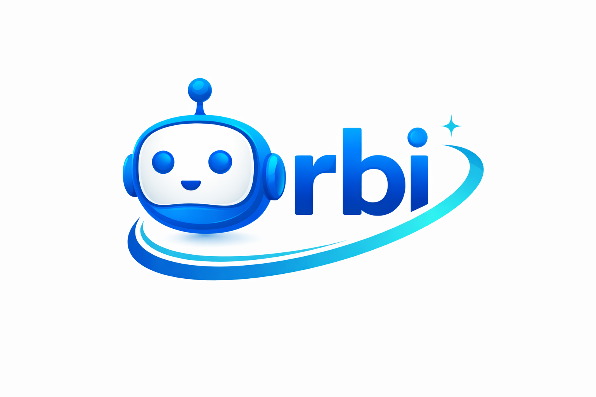

<div align="center">
  

  # Orbi — piloter ses agents de code depuis Telegram et le web

  **Bot Telegram × Dashboard d'administration × Orbi Dev (agents de code distants)**

  [](https://python.org)
  [](https://fastapi.tiangolo.com)
  [](https://mongodb.com)
  [](https://redis.io)
  [](https://docker.com)

</div>

---

## Présentation

Orbi est un projet open source qui permet de **lancer et suivre des tâches de développement confiées à un agent de code distant** (premier fournisseur : [Cursor Cloud Agents](docs/connectors/cursor.md)) depuis un navigateur mobile, avec un bot Telegram pour le support et les outils du quotidien.

> **État du projet.** Le parcours Orbi Dev est implémenté et testé de bout en bout avec un fournisseur *factice*. Il n'a **pas encore été essayé avec un compte fournisseur réel** et l'interface n'a pas été vérifiée visuellement sur un téléphone. Voir [la feuille de route](docs/ROADMAP.md).

| Module | Contenu | Où |
|---|---|---|
| **Orbi Dev** | Projets, clés fournisseur chiffrées, tâches, exécutions suivies (état, historique, pull request, annulation, nouvelle tentative) | Web : `/dev/` |
| **Support** | Tickets guidés par conversation, SLA, satisfaction (CSAT), alertes aux admins | Bot Telegram |
| **Productivité** | Tâches, notes, minuteur de concentration | Bot Telegram |
| **Outils développeur** | Événements GitHub reçus, journal d'erreurs, statistiques d'infrastructure | Bot Telegram (admins) |
| **Dashboard admin** | Utilisateurs, tickets, indicateurs, lien de connexion généré depuis le bot | Web : `/admin/` |
| **Communauté** *(optionnelle)* | Sondages, karma, modération de groupes | Bot Telegram — désactivée par défaut |

Interface du bot en **français, anglais et arabe**.

### Le module Communauté est optionnel

Il est **désactivé par défaut** (`ENABLE_COMMUNITY=false`) : sa modération lit le texte de tous les messages des groupes où le bot est présent, ce qui ne doit être activé que de façon délibérée. Désactivé, ses commandes, boutons et handlers n'existent pas dans le bot.

---

## Orbi Dev en bref

1. Un administrateur ouvre l'interface **depuis Telegram** (bouton « Orbi Dev », Mini App, connexion automatique) ou depuis un navigateur avec le lien magique de `/web`. Les Mini Apps exigent une URL https publique ([ADR-0007](docs/adr/0007-telegram-mini-app.md)).
2. Il enregistre un **projet** (URL https du dépôt) et connecte une **clé fournisseur** : elle est vérifiée, puis chiffrée (Fernet) dans une collection séparée, jamais réaffichée.
3. Il crée une **tâche** : l'agent travaille sur une branche et propose une **pull request**. Rien n'est fusionné ni déployé automatiquement.
4. L'exécution est suivie en arrière-plan ; l'état vit en base, donc recharger la page ou perdre la connexion ne perd rien et ne relance rien.

Garanties de conception ([ADR-0003](docs/adr/0003-durable-execution-model.md)) : identifiants durables créés avant tout appel réseau, lancement idempotent, résultat incertain réconcilié par lecture (jamais relancé à l'aveugle), retries bornés, transitions d'état validées et atomiques.

---

## Démarrage rapide

### Avec Docker (recommandé)

```bash
cp .env.example .env        # renseignez au minimum TELEGRAM_BOT_TOKEN et JWT_SECRET (32 caractères)
docker compose up --build -d
docker compose logs -f bot
```

Le port 8000 n'écoute que sur `127.0.0.1` : placez un reverse proxy HTTPS devant. Détails d'exploitation : [SETUP_GUIDE.md](SETUP_GUIDE.md).

### En développement local

```bash
# Dépendances verrouillées (uv est requis en Python 3.14, voir docs/adr/0006-python-3.14.md)
uv sync --all-extras
source .venv/bin/activate

# MongoDB et Redis
docker run -d --rm -p 127.0.0.1:27017:27017 mongo:7.0.45
docker run -d --rm -p 127.0.0.1:6379:6379 redis:7.4-alpine

cp .env.example .env
uvicorn src.main:app --reload
```

---

## Configuration

Variables principales (liste complète dans [.env.example](.env.example)) :

| Variable | Rôle | Requis |
|---|---|---|
| `TELEGRAM_BOT_TOKEN` | Token du bot ([@BotFather](https://t.me/BotFather)) | ✅ |
| `JWT_SECRET` | Secret applicatif (jetons CSRF du dashboard), 32 caractères minimum en production | ✅ en prod |
| `MONGODB_URI`, `MONGODB_DB`, `REDIS_URL` | Connexions aux services | ✅ |
| `ADMIN_CHAT_ID` | Telegram ID du premier superadmin (créé seulement s'il n'en existe aucun) | recommandé |
| `SECRETS_ENCRYPTION_KEY` | Clé(s) Fernet qui chiffrent les clés fournisseur (plusieurs séparées par des virgules = rotation) | pour Orbi Dev |
| `ADMIN_API_TOKEN`, `DEV_API_TOKEN`, `METRICS_API_TOKEN` | Jetons Bearer des API `/api/v1/admin`, `/api/v1/dev`, `/metrics` ; absents = routes refusées (503) | — |
| `GITHUB_WEBHOOK_SECRET` | Secret du webhook GitHub ; absent = webhook refusé | — |
| `TELEGRAM_WEBHOOK_URL`, `TELEGRAM_WEBHOOK_SECRET` | Mode webhook en production | — |
| `BASE_URL` | URL publique de l'application ; **https requis** pour la Mini App et les boutons-liens | pour la Mini App |
| `ENABLE_COMMUNITY` | Active le module Communauté | — (`false`) |
| `ORBI_DEV_REFRESH_INTERVAL` | Intervalle de suivi des exécutions, en secondes (0 = désactivé) | — (`30`) |
| `ENVIRONMENT` | `development` / `staging` / `production` | — |

La configuration de production est **fail-closed** : démarrage refusé si `JWT_SECRET` est faible ou si `TELEGRAM_WEBHOOK_URL` est défini sans secret.

---

## Routes

| Méthode | Route | Description |
|---|---|---|
| `GET` | `/livez` | Le processus répond (utilisé par le HEALTHCHECK Docker) |
| `GET` | `/health` | Disponibilité de MongoDB et Redis |
| `GET` | `/metrics` | Métriques Prometheus (jeton Bearer) |
| `GET` | `/api/v1/admin/users`, `/tickets` | Lecture seule (jeton Bearer) |
| `GET` | `/api/v1/dev/health/stats`, `/errors/unresolved` | Infrastructure et erreurs (jeton Bearer) |
| `POST` | `/webhook/telegram`, `/webhook/github` | Webhooks entrants (secret vérifié) |
| `GET` | `/admin/` , `/admin/users`, `/admin/tickets` | Dashboard (session administrateur) |
| `GET` | `/dev/…` | Interface mobile Orbi Dev (session administrateur, CSRF sur toute écriture) |

---

## Tests

Les tests utilisent un **vrai MongoDB** (Redis est simulé) :

```bash
docker run -d --rm --name orbi_test_mongo -p 127.0.0.1:27017:27017 mongo:7.0.45
TELEGRAM_BOT_TOKEN=test uv run pytest
```

La CI (GitHub Actions) exécute ruff, la suite sur Python 3.12 / 3.13 / 3.14, un audit des dépendances verrouillées et la construction de l'image Docker.

---

## Architecture

```
src/
├── main.py              # Application FastAPI, cycle de vie, webhooks, /health /livez /metrics
├── core/                # Config, MongoDB (Beanie/PyMongo async), Redis, i18n, logs, sécurité, métriques
├── bot/                 # Application Telegram, claviers, middlewares (logs → auth → i18n → rate limit)
├── handlers/            # Support, productivité, profil, menus, admin, outils développeur, communauté (optionnel)
├── services/            # Tickets, productivité, notifications, planification, développeur, communauté
├── models/              # Documents Beanie (utilisateurs, tickets, productivité, logs, communauté)
├── orbi_dev/            # Orbi Dev : modèles, machine à états, chiffrement, orchestration, connecteurs, worker
│   └── connectors/      # Contrat de connecteur, Cursor Cloud Agents, fournisseur factice (hors production)
├── web/                 # Authentification par lien magique, dashboard, interface Orbi Dev, CSRF
├── api/                 # API Bearer admin et développeur
├── templates/           # Gabarits Jinja2
└── locales/             # Traductions fr / en / ar
```

Chaque message du bot traverse 4 middlewares (`group=-10`) : journalisation, authentification (création de l'utilisateur, bannissements), langue, limitation de débit (fenêtre glissante Redis, 30 requêtes / 60 s).

### Données MongoDB

`users`, `tickets`, `tasks`, `reminders`, `notes`, `api_logs`, `error_logs`, `github_webhook_logs`, et pour Orbi Dev : `orbi_dev_projects`, `orbi_dev_integrations`, `orbi_dev_integration_secrets` (clés chiffrées), `orbi_dev_tasks`, `orbi_dev_executions`, `orbi_dev_events`, `orbi_dev_audit`. Module Communauté : `polls`, `karma_logs`, `moderation_logs`, `group_configs`.

> Les anciennes collections du module boutique supprimé (`products`, `orders`, `promo_codes`) et des écrans développeur supprimés (`api_keys`, `webhook_configs`, `webhook_deliveries`, `api_request_logs`) ne sont **pas** supprimées automatiquement des bases existantes.

---

## Documentation

- [Spécification](docs/ORBI_SPECIFICATION.md) · [Feuille de route](docs/ROADMAP.md) · [Audit initial](docs/AUDIT_INITIAL.md) · [Inventaire des modules](docs/LEGACY_MODULES.md)
- Décisions d'architecture : [ADR-0001 à 0006](docs/README.md)
- [Connecteur Cursor](docs/connectors/cursor.md) — configuration, mapping, hypothèses et limites
- [`cdc.md`](cdc.md) — cahier des charges historique (v4.0), en partie obsolète

---

## Licence

**Aucune licence n'est encore déclarée dans ce dépôt** (pas de fichier `LICENSE`) : en l'absence de licence, le code reste protégé par défaut et ne peut pas être réutilisé librement. À choisir par le propriétaire du projet.
